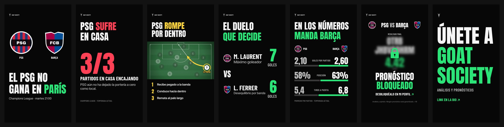

# GOAT SOCIETY STUDIO

Estudio gráfico **local** para crear contenido de fútbol premium (carruseles y posts para TikTok e Instagram) con la identidad de **GOAT SOCIETY** y la dirección de arte **GOAT EDITORIAL**: fondo negro, texto blanco enorme, un solo color de acento y un mensaje por diapositiva.

- Sin suscripciones, sin cuentas, sin APIs de pago, sin marcas de agua de terceros.
- Todo se guarda en tu navegador (IndexedDB): proyectos, escudos, logos, fondos, modelos 3D y ajustes de marca.
- Funciona sin conexión una vez instalado (PWA).
- Lo que ves en el editor es exactamente lo que se exporta: el lienzo del editor y el exportador usan **el mismo motor de pintado** (Canvas 2D), elemento por elemento.

---

## 1. Requisitos

- [Node.js](https://nodejs.org/) 20 o superior (probado con Node 22).
- Un navegador moderno basado en Chromium (Chrome, Edge, Brave, Arc) o Firefox reciente. Safari funciona, pero el desenfoque usa un método alternativo más lento.

## 2. Instalación

```bash
npm install
```

## 3. Arrancar la aplicación en local

```bash
npm run dev
```

Abre <http://localhost:5173>. La primera vez verás la pantalla de bienvenida con la mascota y el botón **Nuevo carrusel de partido**.

## 4. Versión instalable y sin conexión (PWA)

```bash
npm run build      # genera la carpeta dist/ con service worker
npm run preview    # sirve dist/ en http://localhost:4173
```

Abre `http://localhost:4173` y usa **Instalar aplicación** en la barra de direcciones del navegador. A partir de ahí la aplicación (incluidas todas las fuentes) funciona sin conexión.

La carpeta `dist/` es estática: puedes copiarla a cualquier hosting estático gratuito (GitHub Pages, Netlify, Cloudflare Pages…) si quieres abrirla desde otro equipo, pero **no lo necesitas**: la app no depende de ningún servidor. Recuerda que los datos se guardan en el navegador de cada equipo (usa la exportación `.goat.json` para moverlos).

---

## 5. Dirección de arte GOAT EDITORIAL

> Fondo negro. Texto blanco grande. Un único color de acento. Un mensaje por diapositiva. Visuales de fútbol grandes. Impacto inmediato. Mínimas distracciones.

Todas las plantillas siguen el sistema descrito en [`docs/DESIGN-SYSTEM.md`](docs/DESIGN-SYSTEM.md). En [`docs/antes-despues/`](docs/antes-despues/) hay una comparativa antes/después de las 19 plantillas originales y en [`docs/carrusel-goat-editorial.jpg`](docs/carrusel-goat-editorial.jpg) el «Nuevo carrusel de partido» completo.




- **Color**: fondo `#070707`, texto `#F5F5F5`, secundario `#B9B9B9`, separadores `#242424` y **un acento por diapositiva**: verde `#2BE477`, amarillo `#FFD43B`, rojo `#FF4055` o azul `#3B8BFF`. El dorado queda solo para la marca.
- **Tipografía** (local): Anton para titulares y cifras, Barlow Condensed para etiquetas y nombres, Inter Tight para frases de apoyo y Archivo Black como display. Escala fija: titulares 130–170 px, cifras 230–340 px, secundario 55–85 px, apoyo 38–55 px, etiquetas 32–45 px (sobre 1080×1920).
- **Sin aspecto de dashboard**: composiciones abiertas, sin tarjetas, píldoras, brillos ni texturas innecesarias. Las tarjetas solo donde se justifican.
- **Componentes**: comparativa audaz (cifras enormes + barra proporcional gruesa), cifra dominante, cara a cara, racha en letras, ranking con barras, probabilidad 1X2 con barra segmentada, pronóstico sin tarjeta y bloqueado con desenfoque real y candado sólido, pizarras con campo realista y una sola acción destacada.

### Acento e intensidad por diapositiva

Sin nada seleccionado, el panel derecho muestra **Estilo GOAT EDITORIAL**:

- **Acento de la diapositiva**: verde, amarillo, rojo, azul o *Auto* (el del proyecto o el de la marca). Todo lo que usa `$accent` (palabras `[[resaltadas]]`, barras del líder, candados, flechas tácticas…) cambia a la vez.
- **Intensidad visual**: **Mínimo** (solo el mensaje), **Editorial** (por defecto) o **Cinemático** (añade focos, viñeta y grano). Es un ajuste no destructivo: los elementos se ocultan o muestran según su opción «Visible en intensidad» (sección Apariencia), nunca se borran.
- **Aplicar GOAT EDITORIAL**: convierte una diapositiva antigua al nuevo estilo (fondo negro sólido, acentos dorados → acento, barras editoriales, listas sin tarjetas, pronóstico sin tarjeta, atmósfera solo en Cinemático). También para **todo el proyecto**. Se puede deshacer.
- **Igualar todas**: usa el acento y la intensidad de la diapositiva actual en todo el proyecto.

### Vista móvil y zonas seguras

- **Vista previa** abre por defecto a **tamaño real de móvil** (≈390 px de ancho): si se lee ahí en 2 segundos, funciona en el feed. Puedes activar **Zonas seguras** (las áreas que tapan las pestañas, los botones y la descripción de TikTok) y **Simular interfaz**.
- En el lienzo, el botón **Móvil** de la barra de zoom pone el diseño a tamaño de teléfono y el icono de móvil muestra las zonas seguras. Nada de esto se exporta.

### Proyectos antiguos

Los proyectos guardados se abren sin cambios visuales salvo dos migraciones seguras: los textos que imprimían el enlace de la comunidad pasan a «Link en la bio» y el kit de marca actualiza solo los valores que seguían en el ajuste por defecto anterior (fondo, grises, verde/rojo, tipografías). Usa **Aplicar GOAT EDITORIAL** para convertir el resto cuando quieras.

## 6. Cómo se usa el editor

### Flujo rápido (5 minutos)

1. **Nuevo carrusel de partido** → elige los dos equipos (de la biblioteca o escribiendo), competición, fecha, hora y formato.
2. Se crean **7 diapositivas enlazadas**: portada, cifras clave, movimiento táctico, jugadores clave, estadísticas, pronóstico bloqueado y llamada a la comunidad.
3. Rellena tus datos en **Partido**, **Equipos** y **Estadísticas**. Todas las diapositivas se actualizan solas.
4. Ajusta lo que quieras en el lienzo (doble clic en un texto para editarlo; doble clic en una pizarra táctica para mover jugadores y dibujar flechas).
5. **Vista previa** → **Exportar** → ZIP con `goat-society-local-visitante-01.png`, `-02.png`…

### Distribución de la interfaz

| Zona | Contenido |
| --- | --- |
| Barra superior | Nuevo, abrir, guardar, exportar/importar proyecto (.goat.json), deshacer/rehacer, nombre, estado de guardado, tamaño de lienzo, kit de marca, atajos, vista previa y exportar. |
| Barra izquierda | Plantillas, Páginas, Partido, Equipos, Estadísticas, Texto, Formas, Gráficos, Táctica, Mascota, Imágenes, Efectos y Marca. |
| Centro | Lienzo con zoom (Ctrl + rueda), desplazamiento (espacio + arrastrar o rueda), guías inteligentes, cuadrícula, ajuste a cuadrícula y zona segura de TikTok/Instagram. |
| Barra derecha | Propiedades contextuales del elemento seleccionado (o de la diapositiva) y panel de **Capas** con reordenar por arrastre, ocultar y bloquear. |
| Abajo | Tira de diapositivas con miniaturas; arrastra para reordenar, duplica o elimina. |

### Datos compartidos del partido

- Los textos de las plantillas usan **datos vinculados** como `{home}`, `{away}`, `{competition}`, `{date}`, `{time}`, `{venue}`, `{headline}`, `{pick}`, `{handle}`, `{disclaimer}`, `{page}` / `{pages}`… Cambiar «Barcelona» en **Partido** lo cambia en todo el carrusel.
- En **Partido** puedes cambiar el ámbito a **Solo esta diapositiva** para sobrescribir un dato en una diapositiva concreta (aparece «sobrescrito aquí» y un botón para volver al valor global).
- En cualquier texto, `[[palabra]]` la resalta con el **acento de la diapositiva** (p. ej. `El PSG no gana en [[París]]`).
- Los datos de ejemplo están marcados como **ficticios** (banner amarillo y aviso al exportar) hasta que pulses «Ya he introducido mis datos reales».

### Estadísticas y gráficos

- En **Estadísticas** introduce cada métrica con su valor local/visitante (admite `5,43`, `62%`, vacío = «—»). Las barras se recalculan al instante: con `5,43` frente a `1,57` la barra mayor ocupa el ancho completo y la otra el 28,9 %; si cambias a `3,20` pasa al 49 %.
- Opciones por métrica: unidad, decimales y «menor es mejor» (p. ej. goles encajados).
- Elementos de gráfico: barras enfrentadas, de proporción o apiladas, tarjetas de métrica, dato destacado, anillo de progreso, racha (V/E/D), tabla compacta, jugadores clave, bajas y dudas, agenda de partidos, pronóstico y resultados verificados.
- Escalas: por fila, global o con máximo fijo. Valores negativos o no numéricos nunca rompen el diseño.
- La aplicación **no descarga ni inventa estadísticas**: todos los datos los introduces tú.

### Táctica

- Pizarras 2D y 2.5D con marcas reglamentarias: campo completo, medio campo, último tercio o tercio defensivo; cámara **cenital**, **perspectiva** (proyección real) o **isométrica**.
- Formaciones 4-3-3, 4-2-3-1, 4-4-2, 3-5-2, 3-4-3, 5-3-2, 4-1-4-1 y 4-3-1-2.
- **Doble clic** en una pizarra → modo de edición: arrastra jugadores, mueve los rombos dorados de cada flecha o zona, o elige una herramienta (flecha, curva, pase discontinuo, carrera, presión, círculo, zona, foco, balón) y arrastra sobre el campo. Supr elimina el jugador o anotación seleccionada.
- Preajustes: contraataque, presión alta, pase al espacio, desdoblamiento, sobrecarga en banda, transición defensiva, salida de balón y diagonal del extremo (el ejemplo «extremo recibe abierto, conduce hacia dentro y ataca la espalda del lateral»).
- **Estadio 3D real** (Three.js, se carga solo cuando lo usas): jugadores, focos, gradas, niebla y flechas 3D, con cámara ajustable y mapa para mover jugadores. Se renderiza localmente y se integra en la exportación.

### Pronósticos bloqueados

- Elemento **Pronóstico** con modos Normal, **Bloqueado** y **Revelado** (misma composición).
- En modo bloqueado: desenfoque real ajustable, velo, estilo de candado, texto teaser, qué ocultar (pronóstico, pronóstico + cuota o todo) y colores.
- El texto oculto se sustituye por caracteres aleatorios **antes** de difuminarse, así que la imagen exportada nunca permite leer el pronóstico real.
- Es un recurso visual promocional; no hay pagos ni autenticación. Ningún pronóstico se presenta como garantizado y el aviso legal de la marca está incluido en las plantillas.

### Mascota GOAT

Una cabeza de cabra original **facetada (low-poly)** con iluminación real por faceta. Desde **Mascota**:

- **Cinemático** (aura roja, aura verde, oro, obsidiana): luz de contorno, contraluz, dirección de la luz, contraste, niebla, ojos con brillo.
- **Fondo**: grande, parcialmente oculto, con fundido inferior.
- **Icono** plano para insignias y marcas de agua, y **contorno** geométrico.
- Marca: cabecera, firma de pie, insignia circular con texto, marca de agua y logotipo apilado.

### Efectos

Viñeta, foco de estadio, torres de focos, rayos de luz, niebla, iluminación radial, máscara degradada, aurora de color, grano, bokeh, líneas de campo, retícula y líneas de escaneo, además de sombra, resplandor, desenfoque y modos de fusión por elemento. En **Efectos → Atmósferas completas** puedes cambiar el ambiente de una diapositiva de un clic.

---

## 7. Escudos de los equipos

- **Equipos → Escudo** → **Subir** (PNG, JPG, WebP o SVG). El escudo se aplica a **todas** las diapositivas del proyecto.
- También puedes subirlo en **Imágenes** y elegir «Escudo del equipo local/visitante».
- **Guardar en la biblioteca** recuerda el equipo (nombre, siglas, colores y escudo) para futuros proyectos.
- Sin imagen se usa un **escudo genérico original** con los colores del equipo (forma y patrón configurables). No se incluyen escudos oficiales.
- Los SVG se sanean (se eliminan scripts, eventos y referencias externas) antes de guardarse.

## 8. Reemplazar el logo de GOAT SOCIETY

1. **Marca (Kit de marca) → Logo → Subir**.
2. Elige el tratamiento de color: original, marfil, oro o negro.
3. Las cabeceras, insignias y marcas de agua usan tu logo automáticamente (opción «Usar mi logo subido» en cada elemento de marca).

En el kit de marca también cambias nombre, usuario, aviso legal, paleta (incluido el **acento por defecto**), tipografías por función y una marca de agua global opcional. El apartado opcional **Destino de la comunidad** es solo de uso interno: ninguna plantilla lo muestra (las llamadas a la acción son neutras, como «Enlace en la bio»); si quieres imprimirlo, escribe `{community}` en un texto.

## 9. Modelos 3D opcionales (GLB / GLTF)

1. **Mascota → Modelo 3D (GLB/GLTF)** o **Imágenes → subir un `.glb`**.
2. En las propiedades del elemento: cámara (giro, inclinación, distancia, campo de visión), material (original, obsidiana, oro, marfil, cromo) e iluminación (cinemática, estudio, contorno rojo/verde, dorada).
3. Se renderiza con Three.js en tu equipo y se compone en la exportación a la resolución elegida.

Recomendación: usa `.glb` (lleva las texturas dentro). Un `.gltf` con texturas externas no puede resolverlas desde el almacenamiento local. La aplicación **no incluye un modelo 3D de cabra**: si no tienes uno, la mascota facetada 2.5D ofrece el acabado premium sin depender de él.

## 10. Guardar proyectos

- **Autoguardado** continuo en IndexedDB (indicador «Guardado» en la barra superior). Ctrl+S fuerza el guardado.
- **Mis proyectos** (pantalla inicial): abrir, duplicar, exportar o eliminar.
- **Exportar proyecto** (`.goat.json`) incluye el proyecto, el kit de marca y todos los recursos que usa (escudos, fondos, logo, modelos) codificados dentro del archivo: sirve como copia de seguridad o para pasar el proyecto a otro equipo. **Importar** lo restaura como proyecto nuevo.

## 11. Exportar carruseles

**Exportar** (Ctrl+E):

- Carrusel completo en **ZIP** o solo la diapositiva actual.
- **PNG** (máxima calidad), **JPEG** o **WebP** con control de calidad.
- Resolución **1×** (p. ej. 1080×1920) o **2×** (2160×3840).
- Fondo transparente opcional (PNG/WebP).
- Nombres secuenciales: `goat-society-psg-barcelona-01.png`, `-02.png`…
- Se exporta **solo el diseño**: sin guías, sin selección, sin zonas seguras ni interfaz de TikTok/Instagram. La vista a tamaño real, las zonas seguras y la simulación de interfaz existen solo en el editor y en la vista previa.

Formatos de lienzo: Story/TikTok 1080×1920, Instagram vertical 1080×1350, cuadrado 1080×1080 y horizontal 1920×1080. **Tamaño del lienzo** permite cambiar el formato de un proyecto recomponiendo las plantillas o escalando proporcionalmente.

## 12. Atajos de teclado

| Atajo | Acción |
| --- | --- |
| Ctrl/⌘ + Z · Ctrl/⌘ + Shift + Z | Deshacer · rehacer |
| Ctrl/⌘ + S · Ctrl/⌘ + E | Guardar · exportar |
| Ctrl/⌘ + C / V / D | Copiar / pegar / duplicar |
| Supr | Eliminar |
| Flechas (Shift ×10) | Mover selección |
| Ctrl/⌘ + ] / [ | Subir / bajar capa |
| Ctrl/⌘ + A | Seleccionar todo |
| Espacio + arrastrar · Ctrl/⌘ + rueda | Desplazar · zoom |
| + / − / 0 | Acercar / alejar / ajustar |
| RePág / AvPág | Diapositiva anterior / siguiente |
| P | Vista previa |
| Esc | Deseleccionar / salir de la edición táctica |

---

## 13. Biblioteca de plantillas

| Nº | Plantilla | Categoría | Composición GOAT EDITORIAL |
| --- | --- | --- | --- |
| 01 | Matchday Elite | Previas | Dos escudos grandes, titular y fecha |
| 02 | The Big Statement | Previas | Titular gigante a sangre (solo tipografía) |
| 03 | Head to Head | Previas | Afirmación + tres cifras enormes (victorias / empates / victorias) |
| 04 | Matchday Agenda | Previas | Agenda en filas abiertas con hora, escudos y equipos |
| 05 | Statistical Dominance | Estadísticas | Comparativa audaz: cifras enormes y barras proporcionales |
| 06 | The Numbers | Estadísticas | Una sola cifra dominante con etiqueta y frase de apoyo |
| 07 | Key Players | Estadísticas | El duelo de los dos jugadores clave |
| 08 | Performance Comparison | Estadísticas | Una métrica cara a cara con escudos grandes |
| 09 | Form & Trends | Estadísticas | Racha en letras (V/E/D) y una tendencia |
| 10 | Tactical Board | Táctica | Pizarra a todo ancho con una acción destacada |
| 11 | Formation Battle | Táctica | Duelo de sistemas sobre campo cenital |
| 12 | Key Tactical Movement | Táctica | Un movimiento, una flecha gruesa, tres pasos |
| 13 | Premium Prediction | Pronósticos | Pronóstico sin tarjeta: pick enorme y cuota en acento |
| 14 | Locked Prediction | Pronósticos | Pronóstico desenfocado con candado y llamada al perfil |
| 15 | Prediction Reveal | Pronósticos | La misma composición con el pronóstico revelado |
| 16 | Verified Results | Pronósticos | % de acierto calculado y filas abiertas de resultados |
| 17 | GOAT SOCIETY Community | Comunidad | Declaración tipográfica: «Únete a GOAT SOCIETY» |
| 18 | Final Carousel Slide (4 variantes de texto) | Comunidad | Cierre con mensaje y usuario |
| 19 | Estadio 3D | Táctica | Escena 3D con una sola acción en acento |
| 20 | Photo Cover | Previas | Editorial con foto (sube tu imagen en «Foto») |
| 21 | Giant Stat | Estadísticas | Cifra gigante a todo ancho |
| 22 | Ranking | Estadísticas | Ranking con barras gruesas proporcionales |
| 23 | Win Probability | Pronósticos | Probabilidad 1X2 con barra segmentada (opinión, no garantía) |
| 24 | Bajas y dudas | Estadísticas | Bajas de ambos equipos en filas abiertas |
| 25 | Community · Mascota | Comunidad | La mascota como protagonista |

Todas son composiciones paramétricas de elementos editables (no imágenes planas) y se adaptan a los cuatro formatos de lienzo.

## 14. Arquitectura (resumen técnico)

- **React + TypeScript + Vite**, **Tailwind CSS v4**, **Zustand + Immer** (historial de deshacer con agrupación de cambios), **React Konva** para la interacción del lienzo, **Three.js** (carga diferida) para 3D, **idb** para IndexedDB, **JSZip**, **lucide**, fuentes OFL incluidas vía **@fontsource** (Anton, Archivo Black, Barlow Condensed, Inter Tight, Bebas Neue, Big Shoulders, Oswald, Archivo, Inter, Instrument Serif).
- `src/model`: modelo de documento (proyecto → diapositivas → elementos), tokens de marca/datos y cálculo de estadísticas.
- `src/render/painters`: un pintor Canvas 2D por tipo de elemento. El editor (Konva) los invoca desde formas personalizadas y el exportador los invoca sobre un lienzo a la resolución final: **una sola vía de composición**.
- `src/templates`: plantillas como funciones que generan elementos según el formato.
- `src/tactics`: geometría del campo, homografía de perspectiva (invertible para arrastrar en perspectiva), formaciones y preajustes.
- `src/brand/goat.ts`: malla facetada de la mascota con normales para la iluminación.
- `src/db`: persistencia IndexedDB, saneado de SVG y formato `.goat.json`.

## 15. Pruebas

```bash
npm test           # pruebas unitarias (Vitest): estadísticas, tokens, proyección táctica,
                   # formaciones, plantillas, guardado/carga en IndexedDB, .goat.json, SVG, historial
npm run test:e2e   # flujo completo en navegador (Playwright): crear carrusel, equipos,
                   # subir escudos, fecha, titular, estadísticas, pizarra táctica, pronóstico
                   # bloqueado, comunidad, guardar, recargar, exportar ZIP y verificar las imágenes
```

Para la prueba e2e se necesita Chromium de Playwright (`npx playwright install chromium` si no lo tienes).

## 16. Limitaciones conocidas

- Las referencias visuales (capturas) no estaban en el repositorio cuando se construyó la app; el diseño se basa en su descripción. Si las añades en `/references`, sirven como guía para futuros ajustes.
- No se incluyen escudos oficiales de clubes ni un modelo 3D de cabra: se usan escudos genéricos originales y la mascota facetada 2.5D hasta que subas los tuyos.
- Los datos se guardan por navegador y equipo. Borrar los datos del sitio en el navegador elimina los proyectos: exporta copias `.goat.json`.
- El estadio 3D es una escena estilizada (fichas de jugador, focos, gradas simples), pensada para composiciones tácticas, no un estadio fotorrealista. La edición directa sobre el lienzo de jugadores y flechas está disponible en las pizarras 2D/2.5D; en la escena 3D los jugadores se mueven desde el mapa del panel.
- Los `.gltf` con texturas en archivos separados no se resuelven (usa `.glb`).
- En Safari el desenfoque de lienzo usa un método alternativo (más lento en exportaciones a 2×).
- La aplicación no obtiene datos deportivos automáticamente (decisión de diseño: coste cero y sin dependencias externas).
